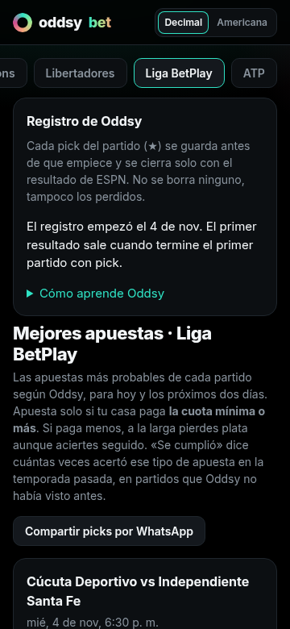
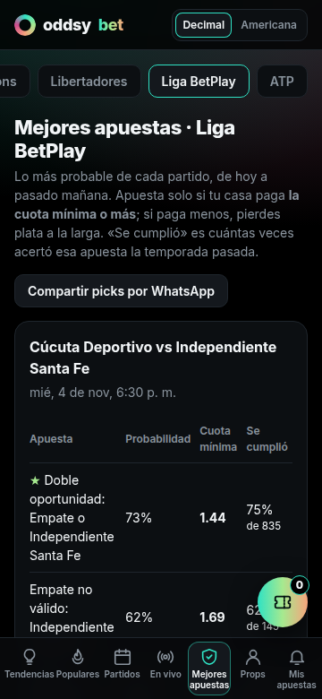
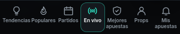

# Auditoría móvil (iPhone y Android) · 2026-11-04

La mayoría de los usuarios entra desde el celular. Esta auditoría mide cada vista de Oddsy en cinco teléfonos y deja anotado qué se arregló y qué falta.

## Cómo se midió

`scripts/mobile-audit.mjs` abre cada vista con Playwright 1.58.2 y la mide dentro de la página. Los iPhone corren en WebKit 26.0, el motor de Safari; los Android, en Chrome 156. Cada perfil trae el ancho, el alto visible, la densidad de píxeles y el navegador del teléfono real.

| Teléfono | Pantalla visible | Motor |
|---|---|---|
| iPhone SE (3.ª gen.) | 375 × 667 | WebKit |
| iPhone 15 | 393 × 659 | WebKit |
| iPhone 15 Pro Max | 430 × 739 | WebKit |
| Galaxy S24 | 360 × 780 | Chrome |
| Pixel 7 | 412 × 839 | Chrome |

Vistas (20 por teléfono): Props, detalle de un prop, Partidos, detalle de partido, En vivo, Mejores apuestas, Tendencias, Populares y Mis apuestas de la NBA; Props, Partidos, detalle y Mejores apuestas de la Liga BetPlay; un detalle de LaLiga; Partidos, detalle y Mejores apuestas de la ATP; Ranking ATP, ficha de un tenista y el boleto abierto.

Qué mide en cada una:

- **Desborde**: cuántos píxeles mide la página de más respecto al ancho del teléfono. Si es más de 0, la página entera se arrastra de lado con el dedo.
- **Cajas fuera**: elementos que pasan el borde derecho sin un contenedor que los recorte.
- **Deslizables**: tablas y filas que hay que mover con el dedo, con el porcentaje que queda oculto y cuántas columnas se ven.
- **Texto cortado**: textos que terminan en «…».
- **Zonas táctiles**: controles con un lado menor a 24 px (mínimo de WCAG 2.2), 44 px (Apple) o 48 px (Android).
- **Letra chica**: texto visible bajo 12 px.
- **Campos que hacen zoom**: campos con letra menor a 16 px, que Safari en iPhone agranda al tocarlos.

Para repetirla (los resultados quedan en `results.json` y las capturas en `shots/`):

```bash
PW=/ruta/a/node_modules/playwright-core node scripts/mobile-audit.mjs https://oddsybet.vercel.app salida
```

`ONLY='iPhone SE (3rd gen),Galaxy S24'` limita los teléfonos. Playwright no es dependencia del proyecto: hace falta una instalación con WebKit y Chrome descargados.

Línea base: producción (oddsybet.vercel.app) el 4 de noviembre a las 5:41 p. m., con el mismo frontend de `e563d2e`. Después de los arreglos: la rama `movil-auditoria` servida en local, con iPhone SE y Galaxy S24, los dos más angostos.

## Resultado

Antes y después en iPhone SE y Galaxy S24, sumando las 20 vistas:

| Problema | Antes | Después |
|---|---|---|
| Vistas que se arrastran de lado | Mejores apuestas en las 3 ligas (162 a 380 px de más en los 5 teléfonos) y el detalle de un prop en Galaxy S24 (12 px) | 0 |
| Textos cortados con «…» | 94 en iPhone SE, 101 en Galaxy S24 | 0 |
| Campos que hacen zoom en iPhone | 6 | 0 |
| Controles con un lado menor a 24 px | 325 | 1 (el «#» de ordenar del ranking ATP, de 21 px de ancho) |
| Controles con un lado menor a 44 px | 907 de 1291 en iPhone SE, 905 en Galaxy S24 | 830 y 811 |
| Alto del texto bajo el título en iPhone SE | En vivo 219 px, Mejores apuestas 198, Mis apuestas 114 | 156, 135 y 93 |

Las 318 pruebas (`node --test`) pasan con los cambios.

| Mejores apuestas antes (Galaxy S24) | Después |
|---|---|
|  |  |

Barra inferior después, en 360 px: 

## Hallazgos

### 1. Mejores apuestas: la página entera se va para un lado (arreglado)

Es lo que se sentía como «tablas que se salen». En las tres ligas medidas la página medía más que la pantalla:

| | iPhone SE | iPhone 15 | Pro Max | Galaxy S24 | Pixel 7 |
|---|---|---|---|---|---|
| NBA | +217 px | +199 | +162 | +232 | +180 |
| Liga BetPlay | +365 | +347 | +310 | +380 | +329 |
| ATP | +222 | +204 | +167 | +238 | +186 |

En la Liga BetPlay de un Galaxy S24 la página medía 740 px en una pantalla de 360. Como el navegador agranda el área de la página, la barra inferior se estiraba a 740 px (la mitad de las pestañas quedaba fuera) y el botón del boleto quedaba en x = 668, fuera de la vista.

Causa: `th, td { white-space: nowrap }` en `public/styles.css` vale para todas las tablas, y las de Mejores apuestas (`public/views/picks.js`, la de cada partido y la del registro) no tienen contenedor con desplazamiento. «Doble oportunidad: Empate o Independiente Santa Fe» no podía partirse en líneas.

Arreglo: en esas dos tablas el texto se parte en líneas y, bajo 600 px, las celdas llevan 5 px de relleno a los lados. Se probó inyectando el CSS sobre producción antes de cambiar el código: en Galaxy S24 e iPhone SE la página pasó de 740 px a 360 y 375, y las 4 tablas de la Liga BetPlay caben en su tarjeta.

### 2. Barra inferior: nombres cortados con «…» (arreglado)

Siete pestañas en 360 px dejan 46 px por pestaña, y con letra de 11 px «Tendencias» necesita 61, «Populares» 53, «Mis apuestas» 71 y «Mejores apuestas» 94. Se veían «Tende…», «Popul…», «Mejor…», «Mis ap…».

Causa: `.side a` (reparto en partes iguales) y `.side a span` (una sola línea con «…») en `public/css/shell.css`.

Arreglo, solo bajo 768 px: letra de 10 px, el nombre puede bajar a una segunda línea y cada pestaña mide al menos su palabra más larga. «Mejores apuestas» y «Mis apuestas» quedan en dos líneas y la barra pasa de 64 a 68 px de alto. Se probó primero con corte de palabra (`hyphens`), pero Chrome sin diccionario no cortó «Tendencias» y la montó sobre «Populares».

### 3. Safari en iPhone acerca la página al tocar un campo (arreglado)

Safari hace zoom al enfocar un campo con letra menor a 16 px, y el usuario tiene que alejar con los dedos después. Pasaba en 6 campos: la línea y el filtro local/visita del detalle de un prop (14 px) y los 4 selectores de Tendencias (13 px).

Causa: `input, select, textarea { font-size: 14px }` en `public/styles.css` y `.ins-sel select { font-size: 13px }` en `public/css/insights.css`.

Arreglo: 16 px en campos bajo 700 px de ancho, y se quitó el 13 px de Tendencias.

### 4. Botones y enlaces chicos para el dedo (arreglados los peores)

En iPhone SE, de 1291 controles medidos en las 20 vistas, 325 tienen un lado menor a 24 px y 907 menor a 44 px. Los más usados y más chicos:

| Control | Tamaño | Vista |
|---|---|---|
| Títulos para ordenar la tabla de Props | 49 × 18 | Props |
| «Detalles del partido →» | 168 × 18 | Partidos |
| «Apuestas del público» | 317 × 18 | Partidos |
| «¿Cómo leer estas cuotas?» | 358 × 18 | Detalle de partido |
| «← Partidos», «← Props», «← Ranking ATP» | 20 de alto | Detalles |
| Cada mercado del detalle (desplegable) | 24 de alto | Detalle de partido |
| «Cómo aprende Oddsy» | 23 de alto | Mejores apuestas |
| Botones de cuota del detalle | 53 × 31 | Detalle de partido |
| Quitar un pick del boleto | 28 × 28 | Boleto |
| «Decimal» / «Americana» | 63 × 28 | Cabecera |

Arreglo: a los enlaces y títulos de ordenar se les dio relleno de 12 px que un margen negativo devuelve, así el área de toque llega a ~42 px sin mover nada en pantalla. Los desplegables tienen 10 px de relleno, los botones de cuota 44 px de alto y la X del boleto un área invisible de 44 × 44.

En una segunda pasada se sumaron los nombres de jugadores en las tarjetas de Tendencias (96 × 23) y los de tenistas en las tablas de tenis (21 de alto), con el mismo truco.

Quedan bajo 44 px: Decimal/Americana (28 px; para agrandarlos hay que rehacer la cabecera), el logo de inicio (27 px), las ligas, fechas y pestañas (32 a 37 px: pasan WCAG pero no Apple) y los botones + de la tabla de Props.

### 5. Detalle de un prop: 12 px de más en 360 px (arreglado)

En Galaxy S24 las pestañas del panel del partido («Enfrentamiento», «Alineaciones», «Tendencias») medían 342 px en un panel de 304, y el panel ensanchaba la página.

Causa: `.pp-side` es una rejilla cuya columna toma el ancho mínimo de su contenido, y las pestañas no se encogen (`white-space: nowrap`, `public/css/props.css`).

Arreglo, bajo 700 px: la columna del panel puede encogerse y las pestañas usan letra de 12 px con menos relleno.

### 6. Nombres cortados en Tendencias (arreglado)

En las tarjetas de Tendencias el nombre del jugador terminaba en «…» cuando pasaba de 96 px: «Ausar Thompson» necesita 126. En Galaxy S24 había 31 nombres cortados en la vista de la NBA. Bajo 700 px el nombre ahora baja a una segunda línea.

### 7. Textos largos bajo el título (arreglado)

Se reescribieron más cortos los textos de En vivo, Mejores apuestas (y el del registro), Tendencias, Populares, Mis apuestas, el ranking ATP y la bienvenida. En total pasan de unas 460 a unas 320 palabras. En iPhone SE el texto bajo el título de En vivo baja de 219 a 156 px de alto, el de Mejores apuestas de 198 a 135 y el de Mis apuestas de 114 a 93, así que el contenido sube a la vista.

### 8. Tabla de Props: se ve poco y se pierden los títulos (sin cambiar)

Tiene 13 columnas y en el celular se ven 3 a 5; queda oculto del 58 % (Pro Max) al 66 % (Galaxy S24). Las dos columnas fijas (+ y Jugador) ocupan 230 px: el 67 % del ancho de la tabla en iPhone SE y el 71 % en Galaxy S24. Sin deslizar se ven jugador, apuesta, línea y probabilidad; Justa, Oddsy y los aciertos quedan a la derecha.

Al bajar 600 px por la lista, la fila de títulos queda en y = −598: los títulos fijos (`position: sticky`) no funcionan dentro de un contenedor con desplazamiento horizontal, así que en una lista de 50 filas no se sabe qué es cada número.

En iPhone SE la tabla empieza en y = 767 con una pantalla de 667: la primera fila no se ve sin bajar.

No se cambió porque hay que decidir qué columnas importan en el celular. Opciones: ocultar las de aciertos bajo 600 px y dejar Línea, Prob. y Oddsy, o pasar a tarjetas por prop.

### 9. Tablas de tenis (sin cambiar)

En la ficha de un tenista, en Galaxy S24, se ve 1 de 9 columnas (la fecha) y el 75 % queda oculto; el rival está fuera de la vista. En el ranking ATP se ven 2 de 5 (37 % oculto).

### 10. Letra chica (sin cambiar)

Hay texto bajo 12 px en todas las vistas, casi siempre de 11 px (etiquetas y textos secundarios). Lo más chico: 7.2 px en las iniciales de las banderas que no cargan en la ficha de tenista, 9 px en la flecha de ordenar, 9.2 px en el conteo de racha («4/5») de las tarjetas de partidos y 10 px en los rótulos de los gráficos del detalle de un prop.

### 11. Otros datos

- La cabecera (56 px) y la barra inferior (64 a 65 px) ocupan siempre del 14 % (Pixel 7) al 18 % (iPhones) del alto de la pantalla.
- Filas que se deslizan a propósito: ligas (56 % oculto en Galaxy S24, sin pista visual porque la barra de desplazamiento está escondida), fechas de Partidos (83 %), estadísticas del detalle de un prop (74 %) y pestañas del detalle de partido (36 %).
- El detalle de partido tardó unos 17 s en quedar sin pedidos de red en producción, en los 5 teléfonos y las 3 ligas; las demás vistas, de 1.5 a 4.5 s.
- Al final de cada página nada quedó tapado por el botón del boleto ni por la barra inferior.

## Lo que no se midió

- Teléfonos físicos: WebKit y Chrome emulados reproducen el diseño, pero no el teclado ni la barra de Safari que se esconde al bajar.
- iOS 17 o anterior: `backdrop-filter` no lleva el prefijo `-webkit-`, así que ahí la cabecera y la barra pierden el desenfoque (el fondo semitransparente sigue).
- Celular de lado: no hay `safe-area-inset-left/right`, y con `viewport-fit=cover` la muesca del iPhone puede tapar el borde.
- Contraste de colores y lector de pantalla.
